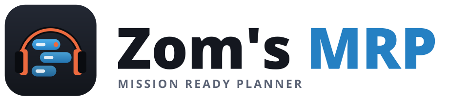
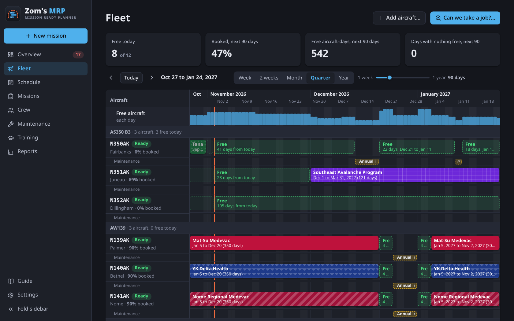
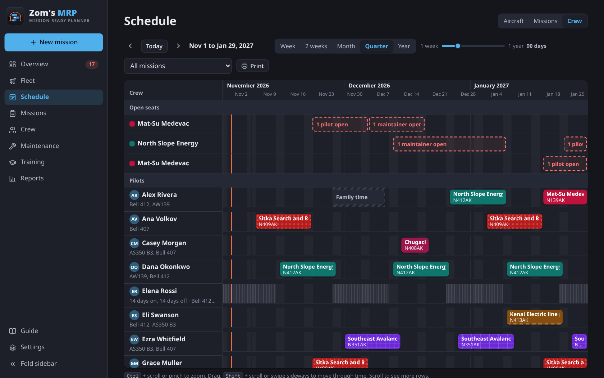
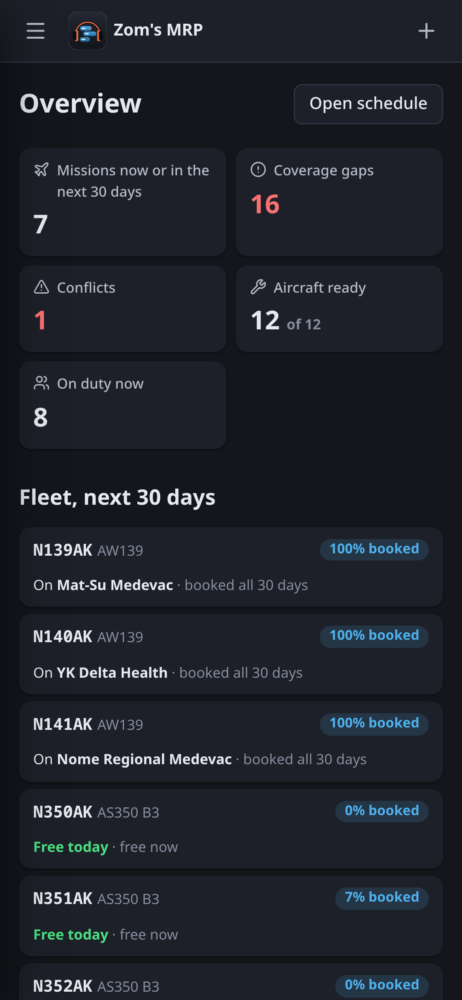
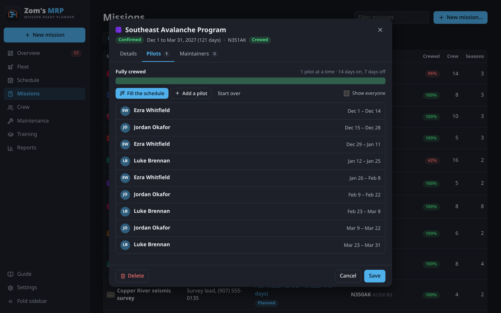

<p align="center">
  <picture>
    <source media="(prefers-color-scheme: dark)" srcset="branding/mrp-logo-dark.png">
    
  </picture>
</p>

<p align="center">
  <b>Every mission crewed, every aircraft planned.</b><br>
  A free helicopter mission planner: fleet board, crew roster and Gantt chart in one, with the checks built in.<br>
  Runs on Windows, macOS and Linux, or on your own server with Docker for the whole team.
</p>

<p align="center">
  <a href="https://github.com/ZomBeatz/Zoms_MRP/releases/latest"></a>
  <a href="https://github.com/ZomBeatz/Zoms_MRP/releases/latest"></a>
  <a href="https://github.com/ZomBeatz/Zoms_MRP/releases/latest"></a>
  <a href="https://zombeatz.github.io/Zoms_MRP/"></a>
  <a href="#running-on-a-server"></a>
</p>

<p align="center">
  
</p>

## Quick start

**Just want to look around?** Try the [online demo](https://zombeatz.github.io/Zoms_MRP/) in your browser. It has made-up data from an operator in Alaska, hands-on lessons and tours, and your changes only stay in your own browser.

1. **Download** the file for your computer from the [latest release](https://github.com/ZomBeatz/Zoms_MRP/releases/latest) (under **Assets** at the bottom):

   | Your computer | File to download | Then |
   |---|---|---|
   | **Windows 10/11** | `Zom’s MRP_(version)_x64-setup.exe` | Open it. If Windows says *"Windows protected your PC"*, click **More info > Run anyway**. |
   | **Mac** (Apple silicon or Intel) | `Zom's MRP_(version)_universal.dmg` | Open it and drag **Zom's MRP** to **Applications**. If macOS says it can't check the app, see [the Mac question](#questions) below. |
   | **Linux** | `.deb` (Ubuntu, Mint, Debian), `.rpm` (Fedora, openSUSE) or `.AppImage` (any) | Open it with your software installer. For the AppImage: right-click > Properties > allow running, then open it. |

2. **Open Zom's MRP.** It opens empty, and the **Getting started** card on the Overview lists what to add, in order: aircraft, training, pilots, maintainers, then each customer as a mission.
3. No account or sign-up needed. Your plan is saved on your own computer.

The **Guide** in the sidebar (or **?**) explains every part, with step-by-step answers for everyday jobs. For a team sharing one plan, see [Running on a server](#running-on-a-server).

## What it does

Like a fleet board, a crew roster and a Gantt chart in one, with the checks built in.

| | |
|---|---|
| **Fleet** | Every tail over time, grouped by type, with its missions, maintenance and free windows. **Can we take a job?** says which tails and crew could take new work. |
| **Schedule** | A Gantt chart by aircraft, mission or person, from a week to a year. The crew view puts open seats on top. |
| **Missions** | One customer's work, with the training it needs and its regular crew. Each season holds the dates, the aircraft by tail number and the crew sizes. |
| **Rotations** | Set a rotation like 21 on, 14 off, and **Fill the schedule** rotates free, rated, current people through it. |
| **Crew and training** | Pilots and maintainers, their type ratings, time off and training. People only need the training of the missions they work. |
| **Checks** | The Overview lists every open seat, double booking, missing rating, expired course and too-long hitch. Tap one to fix it. |
| **Reports** | Days per mission, aircraft use and how busy each person is, for any dates. A **PDF report** or **Excel report** with charts and color-coded boards. |
| **Privacy** | No ads, no tracking and no cloud account. The plan stays on your computer or your own server. |

<table>
  <tr>
    <td width="66%"></td>
    <td rowspan="2" width="34%"></td>
  </tr>
  <tr>
    <td></td>
  </tr>
</table>

<details>
<summary><b>The full feature list</b></summary>

- **Fleet board**: every tail grouped by type, its missions and maintenance, free windows, and a row showing how many aircraft are free each day
- **Can we take a job?**: checks dates, type, pilots and training against the whole fleet and crew, and says when a busy tail is free next
- **Missions and seasons**: each customer is a mission with its contact, color and pattern; each season is one stretch of dates on one or more aircraft, with **Copy to next season**
- **Rotations**: a pilot and a maintainer rotation per season, **Fill the schedule** and **Start over**, and fixed personal rotations with days off shaded
- **Shifts**: one line per shift, open seats in date order, and only people who are rated, current, free and on rotation offered (**Show everyone** for the rest)
- **Training**: courses with how often they're renewed, set per mission, a **Who's current** view, and warnings before training runs out
- **Maintenance**: jobs on an aircraft with the maintainers on them, which can ground it
- **Checks**: open seats, double bookings, bookings during time off or maintenance, missing ratings, expired training, too many pilots for the seats, and hitches longer than the limit
- **Schedule**: by aircraft, mission or person, narrowed to one mission, with drag, pinch and Ctrl + scroll to zoom
- **Reports**: fleet use, days per mission, crew load and how much flying was fully crewed, for any period, as a **PDF report** or **Excel report** with charts and boards colored like the app
- **Phone-friendly**: card lists, full-screen forms and the back button stepping back through what you opened
- **Guide**: how each part works, step-by-step answers for everyday jobs and a key to the colors
- **Data safety**: a copy every day for a month in the desktop app, backups you can save and restore, and undo
</details>

## What people use it for

| | |
|---|---|
| **Contracts** | fire season standby, medevac standby, utility patrol, survey work, external load and lift jobs |
| **Crew** | 14-day hitches, seat coverage, days off, type ratings, time off and sick calls |
| **Fleet** | which tail flies which job, inspections, repairs, aircraft use, taking on new work |
| **Training** | NVG, mountain flying, over water, recurrent training, renewals coming up |

## Running on a server

For a team: everyone signs in to the same plan from their own browser. Admins decide who has access.

- Accounts with roles: **Admin** (manages people), **Scheduler** (changes the plan), **Viewer** (looks only).
- Two people saving at once can't overwrite each other, and changes others make show up on their own.
- Locked after repeated wrong passwords, an activity log, and a copy of everything every day.
- **Export to Excel** for anyone who'd rather see it in Teams.

**With Docker** (any Linux server or VPS, with a domain name pointed at it): put your domain in `deploy/Caddyfile`, then

```bash
docker compose up -d
```

Open `https://your-domain` and create the admin account right away. Caddy gets the https certificate by itself. More in [SECURITY.md](SECURITY.md).

## Questions

<details>
<summary><b>Where is my data saved?</b></summary>

In the desktop app, in a file in the app's data folder on that computer, with a copy kept every day for a month. On the server, in the server's database. In a browser, in that browser's storage. Use **Settings > Your data > Save a backup** now and then.
</details>

<details>
<summary><b>How do I share the plan in Teams?</b></summary>

**Reports > Excel report** (or **PDF report**) makes one for any dates, and **Settings > Your data > Export to Excel** makes a workbook of the whole plan, to post in a channel. In the desktop app, **Settings > Excel copy for Teams** keeps one up to date in a folder: pick a Teams channel's folder that OneDrive syncs, and the team always has the latest.
</details>

<details>
<summary><b>Windows or macOS warns about the app. Is it safe?</b></summary>

That warning appears for apps that aren't signed with a paid certificate yet. The installers are built by GitHub straight from the code in this repository. On Windows choose **More info > Run anyway**.

On a Mac, open the `.dmg` and drag **Zom's MRP** to **Applications**. The first time you open it, macOS says it can't check it: choose **Done**, then go to **System Settings > Privacy & Security**, scroll down to the message about Zom's MRP and choose **Open Anyway**. On macOS 14 or older, right-clicking the app and choosing **Open** also works. After that it opens normally. The Mac app runs on Apple silicon and Intel Macs with macOS 10.15 or later.
</details>

<details>
<summary><b>How does it decide someone can't fly a mission?</b></summary>

They need to be qualified on the aircraft's type, free (not booked elsewhere or on time off), and current on the training the mission needs, for the whole of their hitch. Hitch length and days off come from **Settings > Hitches and days off**.
</details>

<details>
<summary><b>I forgot the admin password</b></summary>

On the server, run `docker exec -it mrp zoms-mrp-server reset-password <username>` and type a new one.
</details>

## For developers

<details>
<summary><b>Running from source, tests and project layout</b></summary>

```bash
npm install
npm run dev      # http://localhost:1430
npm test         # coverage and conflict checks
npm run build    # type-check and build into dist/
npm run build:server && cargo test --manifest-path server/Cargo.toml   # the server
```

- `src/types.ts`: the data model. `src/store.ts`: state, saving, undo and the demo slot. `src/migrate.ts`: opens saves from older versions.
- `src/bookings.ts`: each season joined with its mission, which the pages and checks work with.
- `src/coverage.ts`: every check (gaps, conflicts, qualifications, training, hitches), with tests next to it.
- `src/fleet.ts`: what each tail is doing day by day, free windows, and whether the fleet can take a job (tests next to it).
- `src/components/timeline.tsx`: the drag, scroll and zoom shared by the Schedule and the Fleet page.
- `src/pages/`: Overview, Fleet, Schedule (the Gantt chart), Missions, Crew, Maintenance, Training, Reports, Settings.
- `src/tour.tsx`: the walkthroughs over the demo. `src/pages/Guide.tsx`: the guide.
- `src/sample.ts`: the demo, an operator in Alaska over the past and next 12 months.
- `src/dialogs.tsx`: the forms for each kind of item.
- `src/tokens.css`: the ZomBeatz design tokens.
- `src/backends/`: where the data is kept: this browser, this computer (desktop app) or the server.
- `src/excel.ts`: **Export to Excel**. `src/report.ts`, `src/reportPdf.ts` and `src/reportExcel.ts`: the PDF and Excel reports.
- `server/`: the server (Rust: axum and SQLite), with the web app built in. `Dockerfile` and `docker-compose.yml` package it with Caddy.
- `src-tauri/`: the desktop app (Tauri 2). `npm run app` runs it; `npm run bundle` makes the installer.
</details>

<details>
<summary><b>Making a release, and signing the Mac app</b></summary>

1. Put the new version in `package.json`, `src-tauri/tauri.conf.json` and `src-tauri/Cargo.toml`, and give the changelog a heading for it.
2. Push a tag like `v0.2.1`. The **Desktop app** workflow builds the Windows, Mac (one app for Apple silicon and Intel) and Linux installers and puts them in a draft release. Check it, then publish it. The workflow can also be run from the Actions tab without a tag; the installers are then under the run's Artifacts.

Without Apple secrets, the Mac app is ad-hoc signed and people open it once with **Open Anyway** (see Questions). To have it open with no warning, it needs an Apple Developer account (99 USD a year). Add these repository secrets (Settings > Secrets and variables > Actions) and the next build is signed and notarized:

| Secret | What it is |
|---|---|
| `APPLE_CERTIFICATE` | The **Developer ID Application** certificate exported from Keychain Access as a `.p12`, as base64 (`base64 -i cert.p12`) |
| `APPLE_CERTIFICATE_PASSWORD` | The password chosen when exporting it |
| `APPLE_SIGNING_IDENTITY` | Its name, like `Developer ID Application: ZomBeatz Media (TEAMID)` |
| `APPLE_ID` | The Apple Account email of the developer account |
| `APPLE_PASSWORD` | An app-specific password for it, made at account.apple.com |
| `APPLE_TEAM_ID` | The 10-character team ID from developer.apple.com |
</details>

<details>
<summary><b>Updates: letting the desktop app update itself</b></summary>

The desktop app can download and install new versions itself (Windows, Mac and the Linux AppImage; a `.deb` or `.rpm` gets a link to the release). Updates are signed with a key of your own, so the app only installs what you built. Until the key is set up, builds work as before and just don't update.

Once, on your own computer:

1. Make the key (pick a password and keep both somewhere safe, like a password manager; without them no later version can update):

   ```bash
   npx @tauri-apps/cli signer generate -w ~/.tauri/zoms-mrp.key
   ```

   (Or `npx tauri signer generate …` from inside this folder.)

2. In the repository's **Settings > Secrets and variables > Actions**:
   - **Secrets:** `TAURI_SIGNING_PRIVATE_KEY` with the contents of `~/.tauri/zoms-mrp.key`, and `TAURI_SIGNING_PRIVATE_KEY_PASSWORD` with its password.
   - **Variables:** `TAURI_UPDATER_PUBKEY` with the contents of `~/.tauri/zoms-mrp.key.pub`.

Never commit the key. From the next tagged release on, the draft release also holds signed update files and `latest.json`. Nothing is offered until you **publish** the release; then every installed copy built with the key finds it within a day (or straight away with **Settings > About > Check for updates**). Versions built before the key was set up don't update themselves, so people install the first one by hand.
</details>

## License

[MIT](LICENSE). Icons are [Lucide](https://lucide.dev) (ISC). The names Zom's MRP and ZomBeatz Media and their logos aren't covered by the license.

## Contact

Made by **ZomBeatz Media** · [info@zombeatzmedia.com](mailto:info@zombeatzmedia.com)
